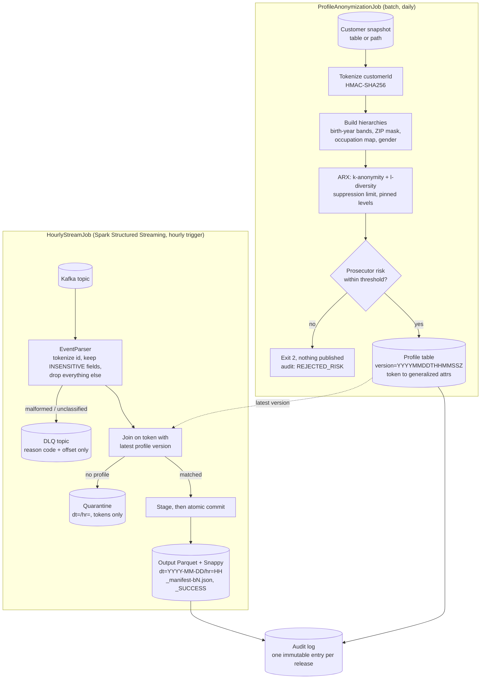

# Customer Anonymizer

Produces an anonymized copy of production customer events for **internal use only**. Events are read
from Kafka, customer IDs are replaced with deterministic HMAC-SHA256 tokens, demographic
quasi-identifiers are generalized to a k-anonymous, l-diverse form with ARX, and the result is written
to hourly Parquet partitions. The job runs inside the production security boundary; only anonymized
data reaches the output location.

> **Status:** reference implementation. `mvn package` (unit tests) and the one-click demo below run
> end to end on Spark 3.5.3 / ARX 3.9.1; run `mvn verify` for the Testcontainers integration test.

## Architecture



### Why two jobs

Running ARX on each hourly batch alone would generalize the same customer differently from hour to
hour. Instead, a daily job anonymizes the whole customer population once and publishes a versioned
`customer_token → generalized attributes` table. The hourly job never generalizes; it only looks
up each event's token in the latest profile version, so every record for a customer carries the same
anonymized values.

Stability across days comes from `profile.pin-previous-levels`: the profile job first tries the
previous version's generalization levels and keeps them while they still satisfy k and l. It searches
for a new optimum (and records `pinnedLevels: false` in the manifest) only when they no longer do.

### Trigger choice: hourly processing-time

Each micro-batch is committed whole to the `dt=/hr=` partition of the hour in which it ran (UTC),
recorded in a batch ledger so replays reuse the same partition. Original event time is kept in
`eventTs`. Event-time windows with 15-minute lateness were rejected because a late event would have to
reopen a partition that consumers may already have read, breaking immutability and the audit trail.
Consumers that need event-time hours filter on `eventTs`.

### Exactly-once

1. Spark records a batch's Kafka offsets in its checkpoint, and marks the batch committed only after
   `foreachBatch` returns, which is after files are durable. Consumer-group offsets are not used for
   progress.
2. Files are written to `_staging/bN/`, renamed into the partition with a `part-bN-` prefix, then
   `_manifest-bN.json` and `_SUCCESS` are written. The manifest is the commit point.
3. On replay, a batch whose manifest exists is skipped. Quarantine is committed first, DLQ next,
   output last.

**Object stores:** S3 renames are copies, not atomic. Readers must list a partition's manifests and
read only the files they name. For stronger guarantees, write to Apache Iceberg instead of raw
Parquet; the commit step is isolated in `AtomicPartitionCommitter`.

**DLQ is at-least-once:** a crash between DLQ publish and output commit republishes DLQ messages.

## Output schema

Hourly output (`stream.output-path/dt=YYYY-MM-DD/hr=HH/`):

| Column | Meaning |
| --- | --- |
| `customer_token` | 64-char hex HMAC-SHA256 of the customer id |
| `key_version` | HMAC key version used for the token |
| `profile_version` | Profile version whose generalized values were attached |
| `<qi>_gen` | Generalized quasi-identifiers, e.g. `dob_gen = 1980-1984`, `zip_gen = 333**` |
| `<sensitive>` | Sensitive attributes, released only inside l-diverse groups |
| `suppressed` | ARX suppressed this customer's quasi-identifiers (all `*`) |
| `<insensitive>` | Passed through unchanged, e.g. `eventType`, `eventTs` |

`OutputSchemaGuard` refuses to write any schema that contains a raw direct-identifier or raw
quasi-identifier column name.

## One-click demo

Needs only Docker with Compose v2 (Docker Desktop, OrbStack, Colima, or Podman with a compose provider).

```bash
./demo.sh            # build, start, open http://localhost:8080
./demo.sh logs       # follow pipeline logs
./demo.sh rerun-profile   # run the daily profile job again (new version, pinned levels)
./demo.sh clean      # stop and delete all demo data
```

The first run downloads images and Maven dependencies (a few minutes). Compose then runs the whole
pipeline on synthetic data, in order:

| Service | What it does |
| --- | --- |
| `kafka`, `kafka-init` | Single-node KRaft broker; creates `customer-events` (3 partitions) and `customer-events-dlq` |
| `snapshot` | Generates 20,000 deterministic synthetic customers as Parquet (`demo/pipeline/generate-snapshot.sql`) |
| `profile-job` | `ProfileAnonymizationJob`: tokenize, ARX k=10 / l=3, risk gate, publish a profile version |
| `stream-job` | `StreamJob` with a 15-second trigger; metrics on `localhost:9095/metrics` |
| `viewer` | Web UI on `localhost:8080`: sends events (good, unknown customer, malformed, extra field, missing id) and shows each raw event beside its anonymized, quarantined or dead-lettered result, plus the profile risk figures, equivalence classes, committed partitions and audit log |

All services share the `demo-data` volume (`/data`). Settings live in `config/demo.conf`; override
`DEMO_TRIGGER`, `DEMO_CUSTOMERS` or `DEMO_PORT` in the environment. The demo uses a fixed,
public HMAC key from `docker-compose.yml` so the viewer can line up "before" and "after"; never use
it anywhere else.

## Setup

Prerequisites: Java 17, Maven 3.8+, Docker (for integration tests and local Kafka), and Spark 3.5.x
for local `spark-submit` runs.

```bash
# 1. ARX is not on Maven Central: download, verify and install it (see lib/README.md)
./scripts/fetch-arx.sh

# 2. Build and run unit tests
mvn package

# 3. Unit + Testcontainers integration tests (needs Docker)
mvn verify
```

## Configuration

Configuration is HOCON (Typesafe Config). `reference.conf` in `anonymizer-common` holds defaults;
`config/common-schema.conf` holds the schema, classification and hierarchies; `config/local.conf`,
`dev.conf` and `prod.conf` hold environment settings. Select one with `-Dconfig.file=...`.

| Key | Purpose |
| --- | --- |
| `schema.fields`, `schema.id-field` | Input fields and types (`string int long double boolean date timestamp`) |
| `classification.<CLASS>` | Lists for `DIRECT_IDENTIFIER`, `QUASI_IDENTIFIER`, `SENSITIVE`, `INSENSITIVE`. Startup fails if any field is unclassified or classified twice |
| `hierarchies.<qi>` | `birth-year-bands` (widths), `zip-mask` (keep-digits), `category-map` (file), `value-star` |
| `unknown-field-policy` | `dlq` (default) or `fail` for fields that appear in messages but not in the schema |
| `crypto.provider` | `env`, `vault`, or `aws-secrets-manager`; `crypto.active-version` selects the key |
| `profile.k`, `profile.l`, `profile.suppression-limit` | ARX privacy models |
| `profile.max-prosecutor-risk`, `profile.max-average-risk` | Risk gate; above either, nothing is published |
| `profile.suppressed-handling` | `STAR` keeps suppressed customers with `*` values; `EXCLUDE` drops them (their events are then quarantined) |
| `stream.trigger` | `"1 hour"`, or `available-now` to drain and stop (tests, backfills) |
| `stream.kafka.options` | Raw Kafka client settings (SASL, TLS). Driver-only; stripped before task serialization |

### Secrets

The HMAC key is never in configuration. Keys are base64, at least 32 bytes, stored by version:

- **env**: `ANON_HMAC_KEY_V1=<base64>` (local, or a Kubernetes secret exposed as env)
- **vault**: KV v2 secret with fields `v1`, `v2`, ...; token from `VAULT_TOKEN` or the Vault Agent token file
- **aws-secrets-manager**: SecretString `{"v1": "<base64>"}`; credentials from IRSA

Executors tokenize, so executors need access to the key provider. Generate a key with
`head -c 32 /dev/urandom | base64`.

### Key rotation

1. Add `v2` to the secret alongside `v1`.
2. Run the profile job with `crypto.active-version = v2`. Its manifest records `keyVersion: v2`.
3. Restart the stream job with `v2`. It refuses to run if the latest profile's key version differs from
   its active key.
4. Tokens change with the key. Outputs keep `key_version`, so consumers joining across a rotation must
   re-tokenize history under the new key (a backfill run) or join within one key version.

## Running locally

```bash
docker compose up -d kafka                  # Kafka on localhost:9092
mvn -DskipITs package
# Put a demographic snapshot in Parquet at /tmp/anonymizer/snapshot (columns per common-schema.conf)
export ANON_HMAC_KEY_V1=$(head -c 32 /dev/urandom | base64)
./scripts/run-local.sh profile              # publishes /tmp/anonymizer/profile/version=...
./scripts/run-local.sh stream               # 2-minute trigger locally
docker compose exec -T kafka /opt/kafka/bin/kafka-console-producer.sh \
  --bootstrap-server localhost:9092 --topic customer-events < scripts/sample-events.jsonl
curl -s localhost:9095/metrics | grep anon_
```

## Deployment (Kubernetes, Spark Operator)

```bash
docker build -t registry.example.com/data-privacy/customer-anonymizer:1.0.0 .
kubectl apply -f deploy/k8s/namespace-and-rbac.yaml
kubectl apply -f deploy/k8s/profile-scheduledsparkapplication.yaml
kubectl apply -f deploy/k8s/stream-sparkapplication.yaml
```

The image replaces Spark's log4j2 SLF4J binding with Logback so logs are structured JSON, and adds
the S3A connector. Size the profile driver for your population: ARX keeps the full snapshot in one JVM.

## Observability

Prometheus metrics on the driver at `:9095/metrics`:

| Metric | Meaning |
| --- | --- |
| `anon_records_in_total` | Records consumed (stream) or customers read (profile) |
| `anon_records_out_total` | Anonymized records written |
| `anon_records_quarantined_total` | Events with no profile match |
| `anon_records_suppressed_total` | Records or customers with suppressed quasi-identifiers |
| `anon_records_dlq_total{reason}` | Dead-lettered messages by reason code |
| `anon_consumer_lag` | Max offsets behind latest across partitions |
| `anon_batch_duration_seconds` | Hourly batch or profile run duration |

The profile job is short-lived, so Prometheus may miss its endpoint; its counts and risk figures are
also in its manifest and audit entry.

Suggested alerts: `anon_consumer_lag` growing for 2 consecutive hours; quarantine rate above 1% of
input; any `anon_records_dlq_total` increase; profile job exit code 2.

## Privacy and security notes

- Logs contain counts, versions, batch ids and reason codes only. No code path logs a record value.
  Library loggers are capped at WARN.
- DLQ messages carry a reason code and the source partition/offset, never payload.
- Quarantine holds tokens and insensitive fields only.
- Pseudonymized data is still personal data under GDPR and similar regimes; output access should
  remain restricted and logged.
- k-anonymity and l-diversity limit, but do not eliminate, linkage risk against arbitrary auxiliary
  data. Review k, l and the hierarchies with your privacy office.

## Known limitations and follow-ups

- **Quarantine replay** is not implemented. After the next profile run, quarantined events can be
  re-joined by a small batch job reading `quarantine/` and writing to the output with new batch ids.
- **Driver memory** bounds the population ARX can process; shard by region beyond tens of millions.
- **Event demographics are ignored** in the stream job: the daily profile is the source of truth, so
  intra-day demographic changes appear after the next profile run.
- **JSON only.** For Avro with Schema Registry, replace `EventParser`'s decoding step.

## Project layout

```
anonymizer-common       config, validation, HMAC tokenizer, key providers, commit/manifest/audit, metrics
anonymizer-profile-job  hierarchies, ARX wrapper, risk gate, versioned profile publish
anonymizer-stream-job   Kafka parsing, profile join, quarantine, DLQ, hourly commit
anonymizer-it           Testcontainers end-to-end hourly cycle
config/                 common schema + local/dev/prod configs, logback.xml
deploy/k8s/             Spark Operator manifests, RBAC, metrics Service
demo/                   one-click demo: pipeline step script, snapshot generator, viewer web app
scripts/                fetch-arx.sh (ARX install), run-local.sh, sample events
```
